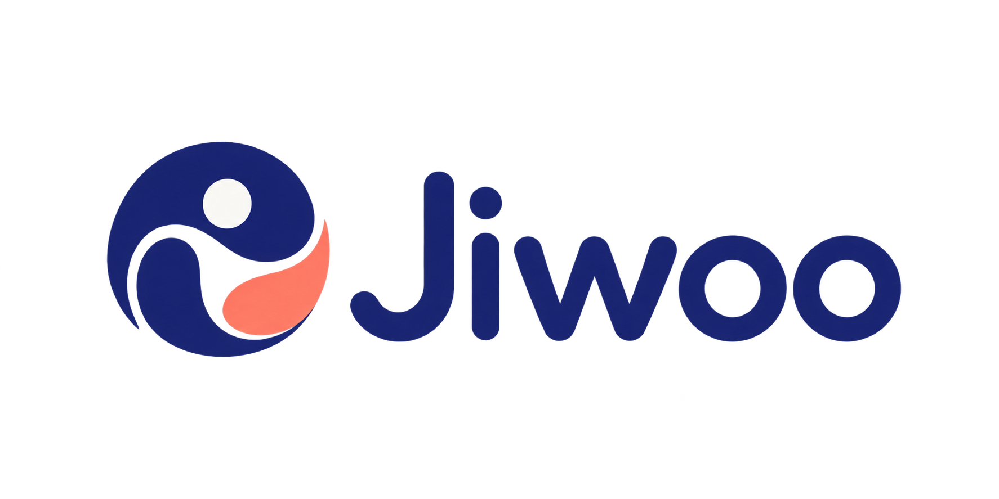
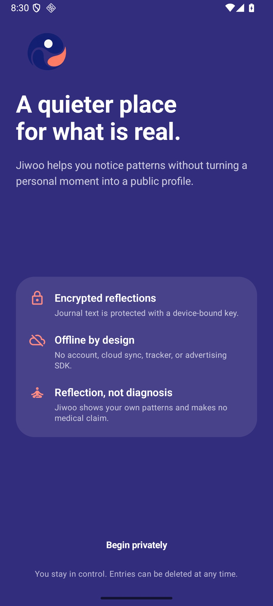
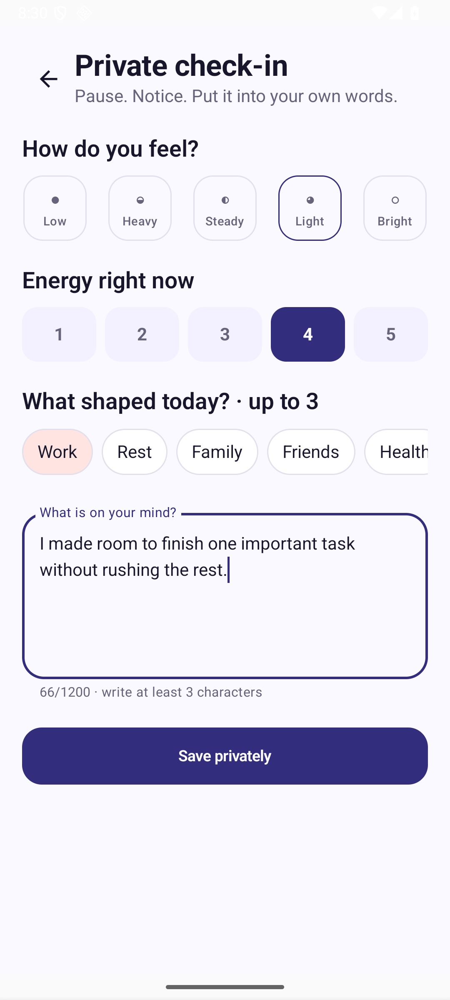
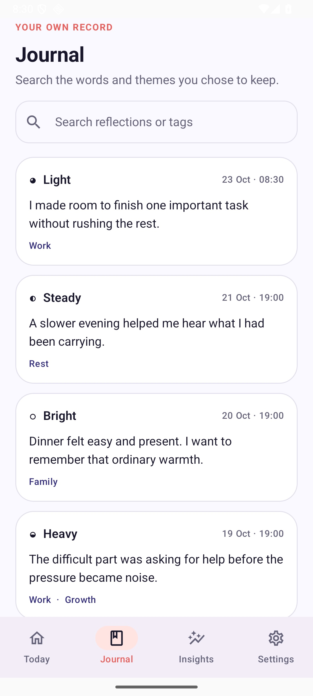
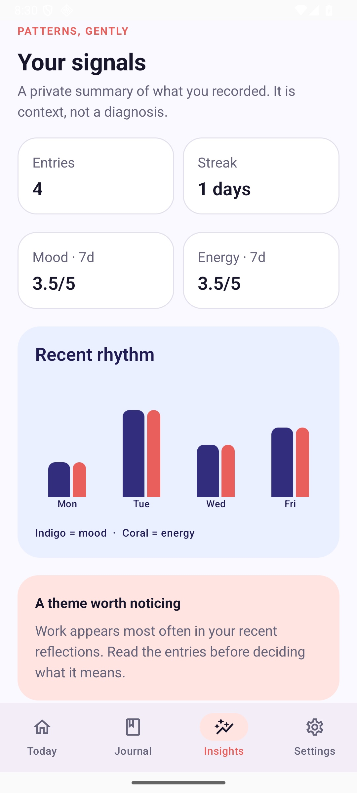
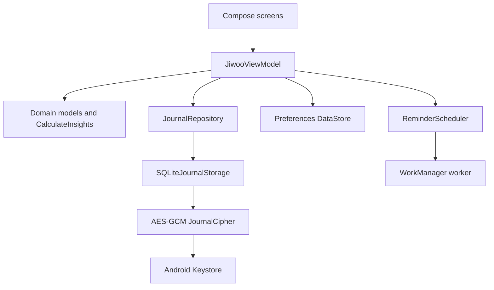

# Jiwoo

<p align="center">
  
</p>

<p align="center">
  <strong>A private place to notice what is real.</strong><br />
  Native Android reflection journal with device-bound encryption, useful patterns, and no account.
</p>

<p align="center">
  
  
  
  
</p>

## The moment Jiwoo is for

Most wellbeing products begin by asking a person to create an account, upload intimate notes, or accept a score that sounds clinical. Jiwoo begins with a quieter promise: write one honest reflection, keep it on the device, and let patterns appear without turning a personal moment into a profile.

A check-in takes about a minute. The person names a mood, energy level, and up to three influences, then writes in their own words. Jiwoo stores the sensitive fields as one AES-GCM encrypted payload, makes the journal searchable after local decryption, and calculates a small set of descriptive signals on the device.

Jiwoo is a reflection tool. It does not diagnose, provide treatment, or replace professional care.

## Product journey

| Arrive privately | Capture the moment | See it in context | Notice a rhythm |
| --- | --- | --- | --- |
|  |  |  |  |

The complete evidence set covers onboarding, empty and saved states, journal detail, insights, and privacy settings in [`docs/images`](docs/images).

## What works

- Private onboarding with explicit product and wellbeing boundaries.
- Mood, energy, tag, and free-text reflection capture with input constraints.
- Encrypted journal persistence using a device-bound Android Keystore key.
- Journal history, local text/tag search, entry detail, and deletion.
- Seven-day mood and energy summaries, streak calculation, and common-theme signal.
- Optional 8:00 PM local reminder through WorkManager.
- Empty, saved, error, and permission-aware states.
- TalkBack-friendly labels, scalable Compose typography, and safe-area navigation.

## Architecture



The dependency direction stays inward: screens express user intent, the ViewModel coordinates use cases, repository interfaces isolate persistence, and Android-specific implementations sit at the edge. [`AppContainer`](app/src/main/java/dev/abiekaputra/jiwoo/AppContainer.kt) is the explicit composition root.

Read the detailed design in [`docs/architecture.md`](docs/architecture.md).

## Why these technologies

| Choice | Reason |
| --- | --- |
| Kotlin + Jetpack Compose | Native Android behavior with a small, testable declarative UI surface. |
| SQLiteOpenHelper | A transparent schema and query boundary without adding code generation to a small local product. |
| AES-256-GCM + Android Keystore | Authenticated encryption with key material generated and retained by the device. |
| Preferences DataStore | Async, transactional storage for non-sensitive onboarding and reminder preferences. |
| WorkManager | Resilient local scheduling that survives ordinary process restarts. |
| StateFlow | One observable state path from persistence to the UI. |

## Privacy model

Jiwoo has no account, cloud sync, analytics SDK, advertising identifier, or network permission. Mood, energy, tags, and journal text are serialized together and encrypted before SQLite receives them. Only record identifiers and timestamps remain queryable metadata.

The Android Keystore key is device-bound. Copying the database alone does not make the journal readable. Android backup and device-transfer extraction are disabled for application data. See [`docs/security.md`](docs/security.md) for the threat model and remaining limits.

## Run locally

### Requirements

- Android Studio or command-line Android SDK
- JDK 21
- Android SDK Platform 37 and Build Tools 36
- Emulator or device running Android 8.0 (API 26) or newer

### Build and install

```bash
git clone https://github.com/abiekaputra/jiwoo.git
cd jiwoo
./gradlew assembleDebug
adb install -r app/build/outputs/apk/debug/app-debug.apk
```

Open **Jiwoo** from the device launcher. No server, API key, or account is required.

## Quality gates

```bash
./scripts/quality.sh
./gradlew connectedDebugAndroidTest
```

The quality gate verifies formatting, unit tests, Android lint, APK assembly, and file-size limits. The emulator journey exercises the real UI from onboarding through a saved reflection, journal, insights, and settings. It also opens the app database and asserts that known journal plaintext is absent from stored payloads.

Test coverage includes:

- Domain validation and preview behavior.
- Empty, average, common-tag, and streak insight calculations.
- Repository initialization, save, delete, and failure-safe boundaries.
- Same-day and next-day reminder timing.
- Full Compose user journey with eight visual checkpoints.
- Encryption evidence against the actual SQLite database.

More detail is available in [`docs/testing.md`](docs/testing.md).

## Project structure

```text
app/src/main/java/dev/abiekaputra/jiwoo/
├── data/       # encryption, SQLite, repository, preferences
├── domain/     # models, contracts, insight calculation
├── reminder/   # scheduling and notification delivery
├── ui/         # navigation, components, screens, theme
└── AppContainer.kt
```

## Engineering decisions and limits

- Search decrypts the local collection in memory. That avoids a plaintext search index and fits a personal journal; pagination would be needed for very large histories.
- The reminder targets a preferred local hour, while WorkManager intentionally allows system-managed delivery variance.
- Deleting an entry removes its row from the live database. Jiwoo does not claim forensic erasure from flash storage.
- There is no export or multi-device sync in this release because both require a separate key-management and consent design.
- The current release is validated locally and is not distributed through Google Play.

The rationale and considered alternatives are recorded in [`docs/engineering-decisions.md`](docs/engineering-decisions.md).

## Status

**Portfolio release 1.0.0** — the local Android product, automated user journey, security assertion, documentation, and screenshot evidence are complete.

## License

Released under the [MIT License](LICENSE).
