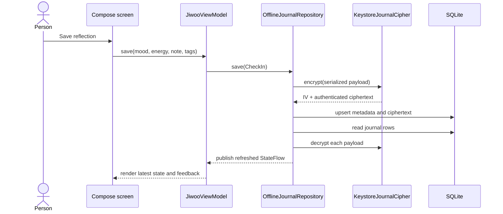

# Architecture

## Product boundary

Jiwoo is a single-device Android product. It has no backend and requests no network access. The boundary is deliberate: a private reflection should remain useful when the device is offline and should not require a remote identity.

## Layers

### UI

Jetpack Compose screens render immutable state and emit user intent. `JiwooApp` owns navigation and system permission orchestration. Individual screens own only temporary form or presentation state.

### Application coordination

`JiwooViewModel` combines repository entries, preferences, calculated insights, and transient feedback into `JiwooUiState`. It coordinates work through interfaces and does not know SQLite or WorkManager details.

### Domain

`CheckIn`, `Mood`, and `ReflectionTag` define valid product language. `CalculateInsights` derives recent averages, daily signals, streaks, and a common theme without Android dependencies, which keeps the logic unit-testable.

### Data

`JournalRepository` separates product behavior from storage. `OfflineJournalRepository` moves blocking work to `Dispatchers.IO` and publishes a `StateFlow`. `SQLiteJournalStorage` owns schema and mapping. `JournalCipher` owns cryptography.

### Device services

DataStore records non-sensitive preferences. WorkManager schedules the optional reminder. Android Keystore creates and retains the journal encryption key.

## Data flow

## Failure behavior

- Invalid domain values fail before persistence.
- A malformed encrypted envelope is rejected instead of partially decoded.
- Repository failures become user-readable feedback without exposing internal exceptions.
- Notification permission denial leaves the journal fully usable.
- A disabled reminder cancels the unique scheduled work.

## Modularity rule

Production Kotlin files remain below 300 lines. Modules are separated by responsibility rather than by file size alone. The repository, cipher, storage, insight calculator, and reminder scheduler each have one reason to change.
